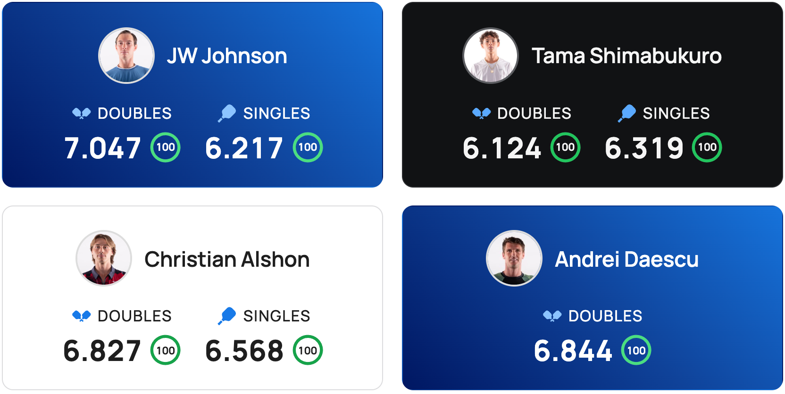

# Pickleball Ratings

This plugin adds a block that shows a pickleball player's doubles and singles ratings, with optional reliability scores, a profile image, and a DUPR ID visitors can copy. You enter the ratings in the block settings. The plugin also includes a Round Robin block for generating and tracking doubles schedules.

## Installation

Until the plugin shows up in the WordPress.org plugins directory, just head over to the [Releases page](https://github.com/ironprogrammer/pickleball-ratings/releases), and for the latest release, expand the "Assets" section and download the **pickleball-ratings.zip** file. Upload and install to WordPress like you would any other plugin.

## How to use

1. On any post, page, or site template, add the "Pickleball Player Ratings" block.
2. In the block settings, enter the player's name and a doubles rating, a singles rating, or both. Reliability scores, a DUPR ID, and a profile image are optional.
3. Pick the Gradient, White, or Black style. Colors and font size can be adjusted in the block's Styles settings.

## Feature Requests ⭐️ and Bug Reports 🪳

Provide feedback through [the Issues page](https://github.com/ironprogrammer/pickleball-ratings/issues/new/choose), and use the appropriate template (bug or feature request).

## Contributing

Your contributions are welcome! See [CONTRIBUTING.md](CONTRIBUTING.md) for details.

## Credits

Icons used in this project are attributed to:

- "Pickleball" by Patrick from [Noun Project](https://thenounproject.com/browse/icons/term/pickleball/) (public domain)
- "Pickleball" by Aether Io from [Noun Project](https://thenounproject.com/browse/icons/term/pickleball/) (CC BY 3.0)
- "Line Chart" by Barracuda from [Noun Project](https://thenounproject.com/browse/icons/term/line-chart/) (CC BY 3.0)
- "Grid" by Saepul Nahwan from [Noun Project](https://thenounproject.com/browse/icons/term/grid/) (CC BY 3.0)
- "Copy" by Saepul Nahwan from [Noun Project](https://thenounproject.com/browse/icons/term/copy/) (CC BY 3.0)
- "Like" by Saepul Nahwan from [Noun Project](https://thenounproject.com/browse/icons/term/like/) (CC BY 3.0)
- "Dislike" by Saepul Nahwan from [Noun Project](https://thenounproject.com/browse/icons/term/dislike/) (CC BY 3.0)
- "User" by Saepul Nahwan from [Noun Project](https://thenounproject.com/browse/icons/term/user/) (CC BY 3.0)
- "Success" by Saepul Nahwan from [Noun Project](https://thenounproject.com/browse/icons/term/success/) (CC BY 3.0)

## License

[As with all things WordPress](https://developer.wordpress.org/plugins/plugin-basics/including-a-software-license/), this plugin is licensed under GPL v2 or later.
